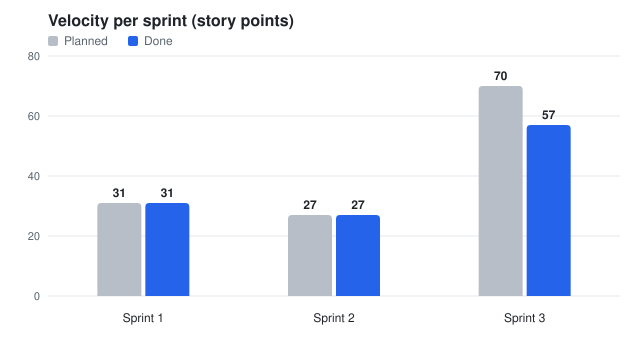
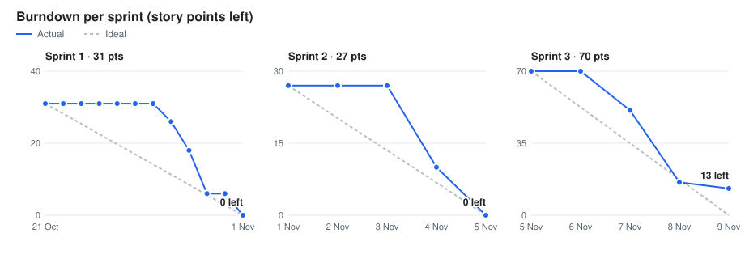

# Agile: Velocity และ Burndown

ผลสุดท้ายของโปรเจกต์ (จบ Sprint 3 วันที่ 8 พ.ย. 2026) จาก issue และ PR ของ repo นี้
และ [GitHub Projects board ของทีม](https://github.com/users/6810660016/projects/1)
ดูแบบ interactive ได้ที่ [dashboard](https://claude.ai/artifact/Nw3kLKjPYEVj3Mqraet61n)

## Sprint

| Sprint | ช่วงวันที่ |
|---|---|
| Sprint 1 | 21–31 ต.ค. 2026 |
| Sprint 2 | 1–4 พ.ย. 2026 |
| Sprint 3 | 5–8 พ.ย. 2026 |

ช่วงวันที่ของแต่ละ sprint กำหนดจากวันที่ merge PR จริงของทีม

## Velocity

| Sprint | Points ที่วางแผน | Points ที่เสร็จ |
|---|---:|---:|
| Sprint 1 | 31 | 31 |
| Sprint 2 | 27 | 27 |
| Sprint 3 | 70 | 57 |
| **รวม** | **128** | **115** |

ค่าเฉลี่ย velocity ประมาณ 38 points ต่อ sprint

## Burndown

แต่ละจุดคือ points ที่ยังไม่เสร็จ ณ ต้นวันนั้น
จุดสุดท้ายของแต่ละ sprint คือสิ้นวันสุดท้ายของ sprint
เส้นประคือเส้นอุดมคติที่ลดลงเท่า ๆ กันทุกวันจนเหลือ 0

| Sprint | Points ที่เหลือแต่ละวัน |
|---|---|
| Sprint 1 | 21 ต.ค. 31 → 28 ต.ค. 26 → 29 ต.ค. 18 → 30 ต.ค. 6 → 1 พ.ย. 0 |
| Sprint 2 | 1 พ.ย. 27 → 4 พ.ย. 10 → 5 พ.ย. 0 |
| Sprint 3 | 5 พ.ย. 70 → 7 พ.ย. 51 → 8 พ.ย. 16 → สิ้นวันที่ 8 พ.ย. 13 |

งานที่ไม่เสร็จใน Sprint 3 (13 points) คือ
#62 เตรียมเดโม (2), #63 Deploy (5), #64 เอกสาร (3) และ #105 ตั้งค่า production (3)

## นับ points อย่างไร

- Story points มาจากชื่อ issue บน board
- วันที่งานเสร็จ:
  - Sprint 1 ใช้วันที่ปิด issue
  - Sprint 2 และ 3 ใช้วันที่ merge PR ที่ทำงานนั้น
- US-12 ถึง US-35 เขียนเป็น story ย้อนหลังหลังจากทำงานเสร็จแล้ว
  issue พวกนี้มี label `retroactive` และระบุ PR ที่เป็นหลักฐานไว้ใน issue

## Retrospective

- Sprint 1: #38 (Start / Stop / Continue) และ #39 (4Ls)
- Sprint 2: #124 (Start / Stop / Continue) และ #125 (4Ls)
- Sprint 3: #126 (Start / Stop / Continue) และ #127 (4Ls)
