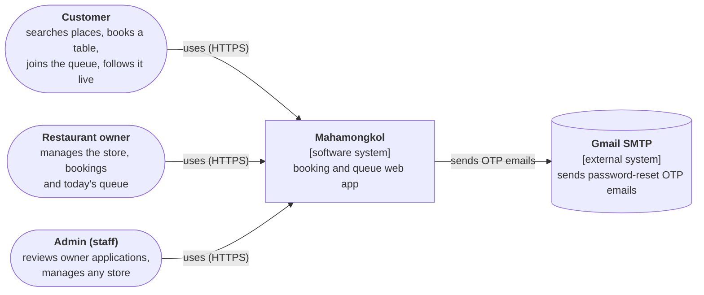
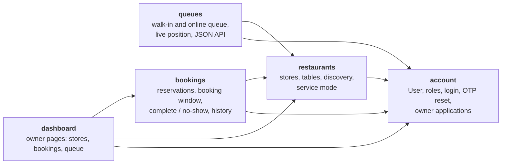
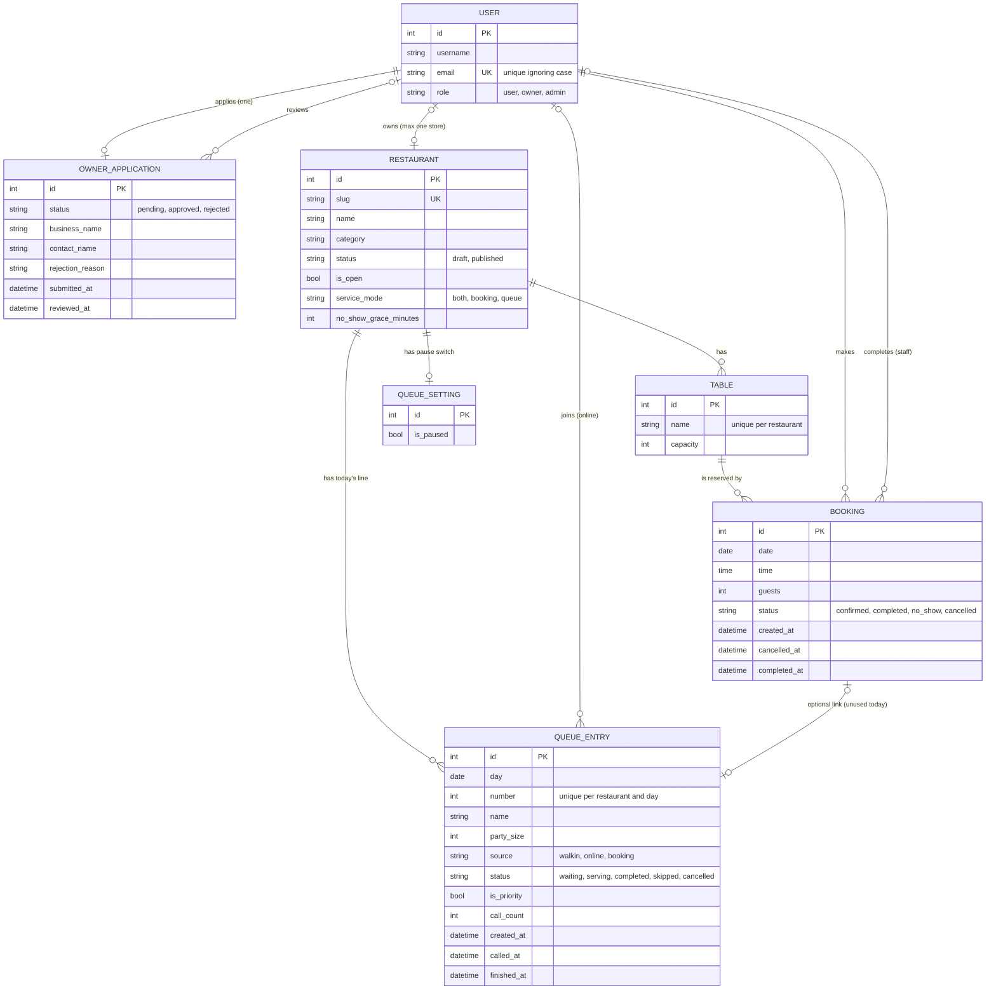

# Architecture (C4) and data model

Mahamongkol (Django project `MongkolQ`) is a **modular monolith**: one Django
project, five apps with one-way dependencies, business rules in service modules,
one relational database. The diagrams below are [Mermaid](https://mermaid.js.org/)
and render on GitHub.

Scope: this describes what is in `main` today. Items marked *planned* are not
built yet.

## 1. System context (C4 level 1)

One account can be both customer and owner: the owner side is unlocked after an
admin approves the owner application, and the user switches between the two UIs.

## 2. Containers (C4 level 2)

```mermaid
flowchart TB
    browser["<b>Browser</b><br/>[Django templates + CSS + vanilla JS]<br/>owner queue page and My Q poll JSON every 4 s"]

    subgraph django["Django web application (one deployable)"]
        direction TB
        web["<b>Django 6.1 (WSGI)</b><br/>URL routing, views, forms,<br/>auth and role checks, CSRF"]
        services["<b>Service layer</b><br/>bookings/services.py<br/>queues/services.py<br/>restaurants/services.py"]
        orm["<b>Django ORM + migrations</b>"]
        cmd["<b>Management command</b><br/>mark_no_shows (run from cron)"]
    end

    db[("<b>Relational database</b><br/>SQLite in development<br/>PostgreSQL on Render (planned)")]
    mail[("<b>Gmail SMTP</b><br/>OTP emails")]

    browser -->|"HTTPS: HTML pages and JSON"| web
    web --> services
    services --> orm
    cmd --> services
    orm -->|"SQL"| db
    web -->|"SMTP (password reset)"| mail
```

Notes:
- Static files live in each app's `static/<app>/` folder plus project `static/`.
- Secrets (email password) come from `.env`. Production settings (`DEBUG`,
  `SECRET_KEY`, `ALLOWED_HOSTS`, HTTPS) and the Render deployment are *planned*.

## 3. Components: the five apps (C4 level 3)

Arrows are Python imports. They only point down toward `account`, so there are
**no circular imports**. `bookings` and `queues` never import each other (a
queue entry refers to a booking only by a string foreign-key reference).

| App | Owns | Main rules (in `services.py`) |
|---|---|---|
| `account` | `User` (role: user / owner / admin), `OwnerApplication` | owner approval and rejection with reason; case-insensitive unique email |
| `restaurants` | `Restaurant`, `Table` | one store per owner; draft / published; open / closed; service mode (bookings, queue, or both) |
| `bookings` | `Booking` | booking window (today to N months ahead); no double booking; cancel; complete; automatic no-show after a grace period |
| `queues` | `QueueEntry`, `QueueSetting` | per-day queue numbers; call next / again; complete; skip; recall; pause; one active entry per guest per store |
| `dashboard` | (no models) | owner pages that call the services of the other apps |

## 4. Data model (ERD)

Integrity rules enforced **by the database**, not only by the code:

| Constraint | Table | Meaning |
|---|---|---|
| `unique_confirmed_booking_per_table_slot` | Booking | one confirmed booking per table, date and time (partial unique index, `status = confirmed`) |
| `unique_table_name_per_restaurant` | Table | table names are unique inside a store |
| `unique_queue_number_per_restaurant_day` | QueueEntry | no duplicate queue numbers per store per day |
| `one_serving_entry_per_restaurant_day` | QueueEntry | only one party is being served at a time |
| `one_active_queue_entry_per_user_and_day` | QueueEntry | a guest cannot hold two active places in one store's line |
| `account_user_email_ci_unique` | User | email is unique ignoring case |
| `Restaurant.owner` is one-to-one | Restaurant | one owner account has at most one store |

## 5. Design decisions

- **Modular monolith:** one deployable keeps the project simple for a team of this
  size; app boundaries and one-way imports keep modules separable.
- **Service layer:** views stay thin. Rules live in `services.py` and are tested
  without HTTP. Writes that must be all-or-nothing use `@transaction.atomic`.
- **Concurrency:** booking and queue changes lock the restaurant row with
  `select_for_update()` before reading counters, so two devices (or a double
  click) cannot take the same number or serve two parties at once. The unique
  constraints above are the second line of defence. Row locks need PostgreSQL to
  take effect; SQLite serializes writes, so a concurrency test on PostgreSQL is
  *planned*.
- **N+1 queries:** list pages use `select_related` (for example bookings with
  their table and restaurant, queue entries with their restaurant).
- **Derived state:** "Booked" is computed from confirmed bookings, never stored,
  so it cannot drift out of sync.
- **Live updates:** the owner queue page and My Q poll a JSON endpoint every
  4 seconds. WebSockets (Channels + Redis) are a possible later step.
- **Roles:** `user`, `owner` (only after approval) and `admin`. Each view is
  wrapped by a decorator (`customer_ui_required`, `owner_ui_required`,
  `admin_ui_required`); owners can only reach their own store.
